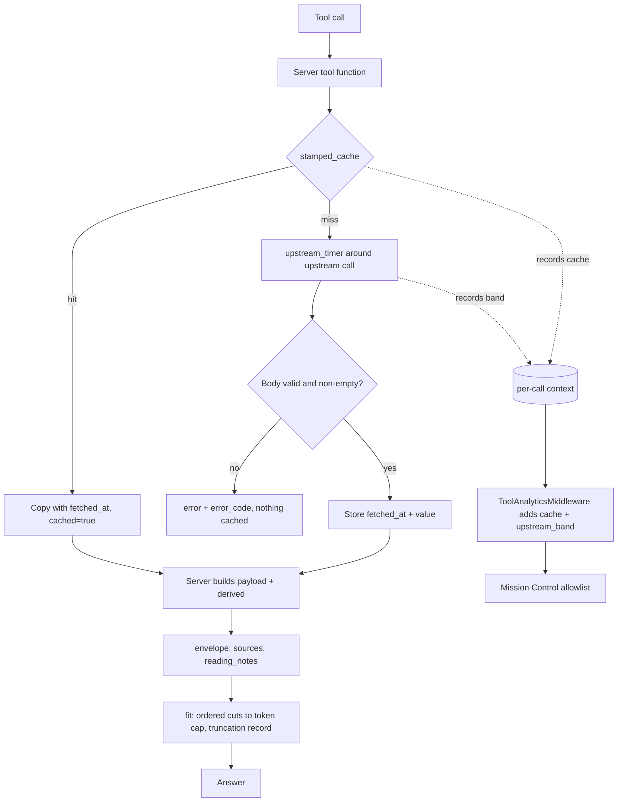
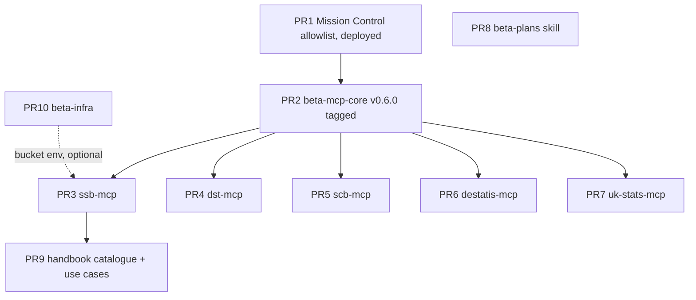

# Shared MCP Response Envelope and Estate Hygiene - Plan

## Goal Capsule

- **Objective:** Anyone at Beta who asks a question through the public statistics MCP servers (ssb, dst, scb, destatis, uk-stats) gets an answer that says where every figure came from and when it was retrieved, whether it came from cache, what was cut and why, and which tool to call next. The same answer shape holds on all five servers and spends fewer tokens than today.
- **Means:** a versioned, additive envelope module in `beta-mcp-core` (KTD1, KTD2), adopted server by server, plus small fixes in `beta-infra`, Mission Control, `beta-plans` and the handbook.
- **Authority:** this plan's Product Contract governs behaviour. KTDs govern mechanism. Each target repo's own AGENTS.md or CLAUDE.md governs branch flow, test commands and deploy. Where they disagree with this plan, the repo wins and the plan is corrected.
- **Stop conditions:** stop and report if any of these happens:
  - a server migration would change the type of an existing response field (violates R2);
  - Mission Control rejects a test event carrying the new analytics props after its deploy (U1);
  - the `beta-infra` terraform plan for U11 shows a delete or replace;
  - a paid model API call becomes necessary (see Open Questions).
- **Execution profile:** several PRs, one per target repository, because each repository merges and deploys on its own. They are grouped in Implementation Units, and each group has a `Waits on:` line.
- **Finishes and ships:** the implementing agent opens, merges and deploy-verifies each PR. A deploy counts as done only when the serving revision's `git-sha` label equals the merged commit and one real tool call returns the new envelope.
- **Target repos:** `beta-mcp-core` (home of this plan), `Mission Control`, `ssb-mcp`, `dst-mcp`, `scb-mcp`, `destatis-mcp`, `uk-stats-mcp`, `beta-plans`, `handbook`, `beta-infra`. File paths in each unit are relative to that unit's named repo.

---

## Product Contract

### Summary

Add a shared response envelope to `beta-mcp-core`, released as v0.6.0. It carries sources, reading notes, coded errors, a truncation record, a token cap and cache stamps. Then move the five statistics servers onto it, add server-computed changes and shares to their data tools, and add follow-up hints. Ship a Claude skill for `beta-plans`, and publish a generated tool catalogue and a use-case library. Fix four `beta-infra` gaps: a PKCE check, the `mcp` host flags, a core-version check, and a cache bucket for statistics metadata.

### Problem Frame

The TRY Innsyn due diligence (`try-innsyn-dd`, `vault/laering/mcp-estatet.md`) compared Beta's MCP estate with a competitor that packages 400 tools behind one consistent answer shape. Beta's servers are smaller and better at reproducibility, but each one shapes its answers differently. The statistics servers return errors as plain strings with no code, and none of them names a licence or a retrieval time. Truncation is a bool in some servers, a dict in `beta-plans` and absent in uk-stats. Cache hits are invisible, so a stale figure looks fresh. A model reading these answers has to learn five dialects. It cannot tell a figure fetched now from one cached six hours ago, and it has to work out changes and shares itself, where it sometimes gets them wrong.

The estate also has drifted plumbing:
- `beta-mcp-core` pins range from v0.1.1 to v0.5.0, in at least five syntaxes, so core fixes do not reach the servers that need them.
- Five live MCP hosts carry `mcp: false` in `beta-infra` `terraform/hostnames.yaml`.
- The Access adoption checklist never checks PKCE.

The DD notes on PR #1 of `try-innsyn-dd` overstated three gaps: a rate limit already exists, Folk analytics is already built, and the core pins have moved. This plan follows the repository evidence in Sources.

### Key Decisions

- **No MCP gateway.** The estate keeps one connector per domain server. (session-settled: user-directed, chosen over a single entry point like TRY's: decided 2026-10-21 for the MobilityHarness, re-confirmed when this plan's scope was agreed.) Governs R1.
- **MCPs stay internal-only.** No customer identity providers, organisations or per-customer rights. (session-settled: user-directed, chosen over opening the servers to customers: the 2026-10-21 decision stands until Johan changes it.) Governs R14.
- **The envelope is additive.** Existing fields keep their names and types, and new keys sit alongside them. (session-settled: user-approved, chosen over one uniform shape that would retype `error` and `truncated`: callers that work today must keep working.) Governs R2.
- **`place-mcp` and Folk are planned separately.** Folk has its own plan in `betamobility/folk`. (session-settled: user-approved, chosen over one combined estate plan: different repos, owners and risks.) Governs R14.

### Requirements

**Envelope in core**

- R1. `beta-mcp-core` offers one envelope contract that any server can adopt. It includes `sources[]`, `reading_notes[]`, `truncation`, `error_code` and a token cap, each documented with its type.
- R2. Adoption is additive. No existing response field changes name or type on any migrated server, and new fields are added beside the old ones.
- R3. Every source a migrated tool used appears in `sources[]` with id, name, URL, licence, attribution, `fetched_at` and `cached`.
- R4. Every failure on a migrated server carries an `error_code` from one closed list in core, next to the existing `error` field.
- R5. No migrated answer exceeds the core token cap. When an answer is cut, `truncation` names what was cut, how much, and how to get the rest.
- R6. The envelope contract is checked by one shared test helper from core that every migrated server runs in CI.

**Statistics servers**

- R7. ssb, dst, scb, destatis and uk-stats return the envelope on every tool.
- R8. Data tools that return a time series also return server-computed change from the previous period and shares of the latest period, where the data supports them.
- R9. Every tool description names the tool to call next where there is an obvious next step, and every error that the caller can fix names the fix.

**Cache and analytics**

- R10. A cached answer says so, with the time its data was fetched.
- R11. Statistics metadata survives a cold start.
- R12. Tool analytics in Mission Control show cache hits and upstream latency bands per tool, with no content, place or filter.

**Skills, catalogue and use cases**

- R13. `beta-plans` ships a Claude skill with its workflow, and the existing ssb, dst and scb skills describe the envelope.
- R14. A generated catalogue lists every tool on every Beta MCP server with its source, licence, cache and privacy notes. A use-case library holds real tool calls with arguments, answers and run dates.

**Infrastructure**

- R15. The Access adoption checklist checks that PKCE is advertised and enforced.
- R16. Every live MCP host carries the correct `mcp` flag, and a test keeps it correct.
- R17. A scheduled check reports any server whose core pin has fallen more than one minor version behind the latest core release.

### Acceptance Examples

- AE1. Covers R2, R4. Given ssb is asked for a table over the cell limit, when it answers, then `error` is still the same human-readable string as before, and `error_code` is `query_too_large`.
- AE2. Covers R3, R10. Given the same `ssb_data` call twice within the cache TTL, when the second answer arrives, then `sources[0].cached` is true and `fetched_at` equals the first call's time.
- AE3. Covers R5. Given a dst call that would produce 40,000 estimated tokens, when it answers, then the answer is under the cap, `truncated` is true as before, and `truncation` lists the rows cut and a `how_to_continue` hint.
- AE4. Covers R8. Given an SSB series with periods 2023 and 2024, when `ssb_data` answers, then `derived` holds the absolute and percentage change from 2023 to 2024 for each series.
- AE5. Covers R12. Given an upgraded server is deployed before Mission Control accepts the new props, when a tool is called, then analytics events are not silently lost (U1 lands first and U2 refuses to emit unknown props).

### Success Criteria

- A model given the same question on ssb and on dst can quote source, licence and retrieval time from both answers without reading tool-specific documentation.
- `tools/list` on each statistics server is no larger after migration than before, measured in characters.
- Mission Control shows `cache` and `upstream_band` for every statistics server within one day of its deploy.

### Scope Boundaries

- Atlas and `beta-plans` keep their envelopes in this plan. Both already carry reading notes and edition or corpus pinning, and their mapping onto core waits for a later plan.
- The tool-choice eval in `beta-plans` is not reused for the catalogue or the use-case library, because it makes paid Anthropic calls.
- No new tools, and no convenience tools with hardcoded table ids. Those were removed from the statistics servers on 2026-04-07 because they go stale.
- Tests running in parallel with deploys in dst, scb and uk-stats are not changed here.
- Considered and not built: a retry layer in core for upstream calls. The servers already handle retries per source (scb rate limiter, uk-stats `PublicHttp`), and nothing in this scope shows lost answers. A measured failure rate in the new analytics would change the call.
- Considered and not built: per-IP limit tuning for Access hosts beyond the check in U11. Traffic is internal and low. The check would show a need.

#### Deferred to Follow-Up Work

- Move atlas (in `dk-mobility`, staging-first) and `beta-plans` onto the core envelope.
- `place-mcp` (separate plan).
- Skills for destatis and uk-stats.
- Making a failing test block the deploy in dst, scb and uk-stats.
- Moving beta-os off core v0.1.1. It is allowlisted in U12 with an expiry.

---

## Planning Contract

### Key Technical Decisions

- KTD1. **A new `beta_mcp_core/envelope.py` module, released as core v0.6.0.** It provides builders for sources, reading notes, truncation and coded errors, plus `fit()` and an exported closed `ERROR_CODES` list. `fit()` is lifted from `beta-plans` `beta_plans/mcp/envelope.py`, which already applies ordered cuts and counts its own note against the cap. Servers call the builders and keep their own payload keys at top level. Core gains no opinion on payload shape.
- KTD2. **Additive field rules per legacy shape.** These rules instantiate R2:
  - `error` keeps its current type on every server: a string in ssb, dst, scb and destatis, an object in uk-stats. A new top-level `error_code` is added on every failure.
  - `truncated` keeps its current bool where it exists, and the new `truncation` object carries `{reason, cut, how_to_continue}`. uk-stats keeps `pagination` and gets `truncation` only when a size cut happens.
  - uk-stats keeps `warnings`. Envelope-level notes go in `reading_notes` and are not copied into `warnings`.
  - The two readings never disagree. Whenever `truncation` is present, a legacy `truncated` bool is true. Whenever `error_code` is present, `error` is present and truthy. `assert_valid_envelope` checks both.
  - Conflict call-out: this leaves two ways to read an error and a truncation on the same answer. A later major version may drop the legacy fields once no caller reads them. That is out of scope here.
- KTD3. **Token cap of 20,000 estimated tokens, estimated as characters divided by three, as in `beta-plans`.** The estimate is deliberately cautious for Nordic JSON and stays under Claude Code's ~25k `MAX_MCP_OUTPUT_TOKENS` (`claude-config` `docs/rules/mcp-patterns.md`). Servers may lower the cap per tool and may not raise it.
- KTD4. **Closed error code list in core.** The list starts as the union of the codes already used in `beta-plans` and uk-stats, plus `upstream_error`, `upstream_rate_limited` and `upstream_empty`:
  - from `beta-plans` and uk-stats: `invalid_request`, `invalid_identifier`, `invalid_cursor`, `invalid_pagination`, `not_found`, `query_too_large`, `source_changed`, `timeout`, `internal_error`;
  - new: `upstream_error`, `upstream_rate_limited` and `upstream_empty`, for the silent-failure cases in `claude-config` `docs/solutions/integration-issues/statistics-apis-fail-silently.md`.

  An unknown code raises at build time. Adding a code is a core minor release.
- KTD5. **Cache stamps through a core `stamped_cache`.** It wraps `ttl_cache`, stores `(fetched_at, value)`, returns a copy, and reports hit or miss. Returning a copy avoids the shared-dict mutation hazard in the current per-server caches. Cache state goes in the JSON body, never only in headers, because Cloudflare strips cache headers on compressed responses (`claude-config` `docs/solutions/integration-issues/cloudflare-edge-strips-strong-etag-on-compressed-responses.md`). An empty or error body is never cached.
- KTD6. **Analytics extension through a context variable, not tool code changes.** `stamped_cache` and a core `upstream_timer` record into a per-call context variable. `ToolAnalyticsMiddleware` reads it at the end of `on_call_tool` and adds two banded props:
  - `cache` = `hit`, `miss` or `none`;
  - `upstream_band` = the existing duration bands.

  Bands, not raw milliseconds, keep the props low-cardinality and content-free. The middleware emits the new props only when the server opts in, so a v0.6.0 server deployed before U1 sends today's props.
- KTD7. **Derived figures are computed only from the rows returned, on the server.** `derived` is an object keyed by series. Each series gets the previous-to-latest change (absolute and percent) when there are at least two periods and both values are numeric. When a category set includes the total, each series also gets its share of the latest period. Suppressed or noisy values (SCB `..`, noise from 2025) yield no derived figure and add a reading note instead. When rows were cut by `max_rows` or `fit()`, shares are not computed, because the denominator may be incomplete. Changes are computed only for series whose two periods are both present.
- KTD8. **Shared metadata cache in a GCS bucket.** The statistics servers have no database, and `beta-infra` already has a cache bucket pattern (`terraform/prod/cache_buckets.tf`). Only metadata and codelists are written there, keyed by source, table and language, and read through to memory. If the bucket variable is unset, the server falls back to memory only. Four rules apply:
  - Blobs keep the original `fetched_at`.
  - Empty or error bodies are never written.
  - A bucket read failure counts as a miss, never an error to the caller.
  - Keys carry a schema version, so a format change starts a new prefix instead of misreading old blobs.

  U3, U4, U5 and U6 deploy safely before U13, running memory-only until the variable appears.
- KTD9. **Core-version check by git ancestry.** Pins are written as tags, SHAs, tarball URLs and `[tool.uv.sources]` revs, and SHA `b87cbfa` sits on a side branch not contained in v0.5.0. The check resolves each pin to a core commit and fails when the release tag one minor below the latest is not an ancestor of that commit. It runs weekly in `beta-infra` against the repos named in `terraform/prod/services.auto.tfvars.json`, and reports through a GitHub issue that it updates rather than duplicates.
- KTD10. **The catalogue and use-case library run real tool calls, with no model in the loop.** Each scenario is a fixed tool call with arguments and simple checks on the answer. Runs are dated and pinned to the server's `build`, corpus or edition where it has one. This keeps the library free to run and repeatable.

### High-Level Technical Design

How a migrated tool call flows through core and back:

PR order across repos:

### Assumptions

None beyond the KTDs. The bets this plan makes are stated there with their reasons.

### Sources and Research

- `beta-plans` `beta_plans/mcp/envelope.py` (`fit`, `MAX_RESPONSE_TOKENS`, `estimate_tokens`, `ERROR_CODES`) and `tests/mcp/test_tools_contract.py`: the pattern for KTD1, KTD3 and the contract helper.
- uk-stats `lib/http.py` (`Fetched.retrieved_at`) and `mcp_server.py` (`invoke`, structured errors): the closest existing shape.
- Mission Control `service/mission_control/analytics/privacy.py` `ALLOWED_PROP_KEYS`: rejects unknown props, so U1 must deploy first.
- `beta-infra` `terraform/shared/main.tf.json` `cloudflare_ruleset.mcp_rate_limit`: the `mcp` flag's only consumer, at 100 requests per 10 s per colo and IP.
- `claude-config` `docs/solutions/integration-issues/statistics-apis-fail-silently.md`: the per-source traps. One example is SSB's cell limit, which answers 400 rather than 403, so today's SSB wrapper misreads it.
- `claude-config` `docs/solutions/architecture-patterns/ci-runtime-check-drift.md`: one shared contract-test code path.
- `beta-infra` `docs/solutions/workflow-issues/live-hostname-cutover-order-under-plan-guard.md`: `plan_guard` hard-fails a delete or replace on main applies.

---

## Implementation Units

| U-ID | Title | Repo, key files | Depends on |
|---|---|---|---|
| U1 | Allow cache and upstream props | Mission Control `service/mission_control/analytics/privacy.py` | none |
| U2 | Envelope module and v0.6.0 | beta-mcp-core `beta_mcp_core/envelope.py`, `cache.py`, `analytics.py`, `testing.py` | U1 deployed |
| U3 | ssb-mcp onto the envelope | ssb-mcp `mcp_server.py`, `lib/*` | U2 |
| U4 | dst-mcp onto the envelope | dst-mcp `mcp_server.py`, `lib/*` | U2 |
| U5 | scb-mcp onto the envelope | scb-mcp `mcp_server.py`, `lib/*` | U2 |
| U6 | destatis-mcp onto the envelope | destatis-mcp `mcp_server.py`, `lib/*`, CI | U2 |
| U7 | uk-stats-mcp onto the envelope | uk-stats-mcp `lib/service.py`, `lib/http.py` | U2 |
| U8 | Skills: plans new, stats updated | beta-plans `skills/plans/`, ssb/dst/scb `skills/*` | U3-U5 for stats parts |
| U9 | Tool catalogue and use-case library | handbook `scripts/mcp_catalogue/`, `catalogue/` | U3-U7 |
| U10 | PKCE check | beta-infra `docs/access-adoption.md`, `scripts/` | none |
| U11 | `mcp` flags and their test | beta-infra `terraform/hostnames.yaml`, `tests/` | none |
| U12 | Core-version check | beta-infra `.github/workflows/`, `scripts/core_pins.py` | U2 tagged |
| U13 | Metadata cache bucket | beta-infra `terraform/prod/cache_buckets*` , `services.auto.tfvars.json` | none |

### PR1: Mission Control analytics allowlist

Waits on: nothing.

### U1. Allow cache and upstream props

- **Goal:** Mission Control accepts `cache` and `upstream_band` props from MCP tool events.
- **Requirements:** R12, AE5.
- **Dependencies:** none.
- **Files:** `service/mission_control/analytics/privacy.py`, its test file beside it, and the ingest enum where `outcome` and `duration_band` values are validated.
- **Approach:**
  1. Add both keys to `ALLOWED_PROP_KEYS`.
  2. Restrict their values to closed enums: `cache` in `hit`, `miss`, `none`; `upstream_band` reusing the duration band values.
  3. Keep the rejection of every other key.
- **Patterns to follow:** how `duration_band` is validated today.
- **Test scenarios:**
  - An event with `cache=hit` and `upstream_band=lt_1s` is accepted.
  - An event with `cache=maybe` is rejected with the existing privacy error.
  - An event with an extra key such as `table_id` is still rejected.
- **Verification:** after deploy, one deliberately valid and one deliberately invalid event are sent to production ingest, and only the valid one lands (`claude-config` `docs/solutions/workflow-issues/a-fix-verified-on-one-side-of-a-boundary-may-be-inert.md`).

### PR2: beta-mcp-core v0.6.0

Waits on: PR1, deployed. Core may emit the new props only after Mission Control accepts them. The reason for a separate PR is a different repository.

### U2. Envelope module, stamped cache, analytics extension, contract helper

- **Goal:** core offers everything R1 to R6, R10 and R12 need, released and tagged as v0.6.0.
- **Requirements:** R1, R2, R4, R5, R6, R10, R12; KTD1, KTD3, KTD4, KTD5, KTD6.
- **Dependencies:** U1 deployed.
- **Files:**
  - create `beta_mcp_core/envelope.py`, `beta_mcp_core/testing.py`, `tests/test_envelope.py`, `tests/test_testing_helper.py`;
  - modify `beta_mcp_core/cache.py`, `beta_mcp_core/analytics.py`, `beta_mcp_core/__init__.py`, `tests/test_cache.py`, `tests/test_analytics.py`, `CHANGELOG.md`, `pyproject.toml`, `README.md` (install line still says v0.4.0).
- **Approach:**
  1. In `envelope.py`, add builders for a source record, reading notes, truncation and a coded error (KTD2, KTD4), plus `fit()` and `estimate_tokens()` lifted from `beta-plans` (KTD1, KTD3).
  2. In `cache.py`, add `stamped_cache` beside the existing `ttl_cache`, leaving `ttl_cache` unchanged (KTD5).
  3. Add `upstream_timer` and the per-call context variable. Teach `ToolAnalyticsMiddleware` an opt-in flag for the two new props (KTD6).
  4. In `testing.py`, add `assert_valid_envelope(result)` and `assert_tool_surface(server, snapshot_path)`, modelled on `beta-plans` `tests/mcp/test_tools_contract.py`. Servers import these, so the contract has one code path.
  5. Bump to 0.6.0, write the changelog, and tag after merge.
- **Execution note:** write `tests/test_envelope.py` first from AE1 to AE3. The envelope is a shared contract, and its tests are the spec servers will run.
- **Patterns to follow:** `beta-plans` `beta_plans/mcp/envelope.py` and `tests/mcp/test_paging.py`.
- **Test scenarios:**
  - A coded error with code `query_too_large` builds, and an unknown code raises.
  - `fit()` applies cuts in the given order until the estimate is under the cap, and records each cut's count in `truncation.cut`.
  - The truncation note itself counts against the cap.
  - A response already under the cap passes through unchanged, with no `truncation` key.
  - `stamped_cache` returns a copy: mutating the returned dict does not change the next hit.
  - `stamped_cache` reports `miss` then `hit`, with the same `fetched_at` on both.
  - An empty or error value is not stored.
  - The middleware with the opt-in off sends exactly `{tool, duration_band}`, as today.
  - The middleware with the opt-in on sends `cache` and `upstream_band` from the context variable, and `none` when the tool used no cache.
  - Context from one call does not leak into the next concurrent call.
  - `assert_valid_envelope` fails on a missing `fetched_at` in a source, and passes on a valid answer.
  - The whole suite passes on fastmcp 3.4.11 and 4.1.2 (the existing CI matrix).
- **Verification:** CI is green on both fastmcp versions, tag `v0.6.0` exists, and the CHANGELOG lists every new public name.

### PR3: ssb-mcp

Waits on: PR2, needed before this group can start, because the build installs core `v0.6.0`. PR10 is optional: without the bucket variable the server runs memory-only. The reason for a separate PR is a different repository.

### U3. ssb-mcp onto the envelope

- **Goal:** every ssb tool returns the envelope, the derived figures, hints and the shared metadata cache.
- **Requirements:** R2 to R11; KTD2, KTD5, KTD7, KTD8; AE1, AE2, AE4.
- **Dependencies:** U2.
- **Files:**
  - modify `mcp_server.py`, `lib/cache.py`, `lib/ssb_client.py`, `lib/parser.py`, `requirements.txt`, `skills/ssb-api/SKILL.md`, `.github/workflows/ci.yml`;
  - create `tests/test_envelope_contract.py`, `tests/test_derived.py`, `tests/fixtures/` (one real SSB response per tool shape).
- **Approach:**
  1. Pin core `v0.6.0`.
  2. Route upstream calls through `stamped_cache` and `upstream_timer`. Metadata and codelists also read through the GCS layer when the bucket variable is set (KTD8).
  3. Add `sources`, `error_code`, `truncation` and `derived` (KTD2, KTD7).
  4. Map HTTP 400 "Too many cells" to `query_too_large`. Today's code reads it as 403, which is the bug from `statistics-apis-fail-silently.md`.
  5. End descriptions with the next tool to call (R9).
  6. Make CI run on pushes to `main` as well as PRs. Today it runs only on PRs and a feature branch, so the contract test would never guard `main`.
- **Patterns to follow:** uk-stats `lib/http.py` for a fetch that carries its retrieval time.
- **Test scenarios:**
  - Covers AE1. A fixture with HTTP 400 "Too many cells" gives the same `error` string as before and `error_code` `query_too_large`.
  - Covers AE2. Two identical `ssb_data` calls give `cached` false then true, with the same `fetched_at`.
  - Covers AE4. A two-period fixture gives absolute and percent change per series in `derived`.
  - A one-period table gives no `derived` key and no error.
  - A series with a missing value in the latest period gets no derived figure for that series only.
  - An empty upstream body gives `upstream_empty` and is not cached.
  - `assert_valid_envelope` passes for every tool, run against the offline fixtures with network calls failing.
  - The existing analytics test still passes (`error` stays truthy).
  - `tools/list` character count is no larger than the recorded pre-migration count.
- **Verification:** after deploy, one real `ssb_data` call through `ssb.betamobility.ai` (or the host in `hostnames.yaml`) returns `sources` with `fetched_at`, and Mission Control shows a `cache` prop for `ssb-mcp`.

### PR4: dst-mcp

Waits on: PR2, needed before this group can start. The reason for a separate PR is a different repository.

### U4. dst-mcp onto the envelope

- **Goal:** as U3, for dst.
- **Requirements:** R2 to R11; KTD2, KTD5, KTD7, KTD8; AE3.
- **Dependencies:** U2.
- **Files:** modify `mcp_server.py`, `lib/cache.py`, `lib/dst_client.py`, `lib/parser.py`, `requirements.txt`, `skills/dst-api/SKILL.md`; create `tests/test_envelope_contract.py`, `tests/test_derived.py`, fixtures.
- **Approach:** as U3, with these deltas:
  - Set an explicit User-Agent, because StatBank resets the connection without one.
  - Note in `reading_notes` when an omitted variable was summed over.
  - Use `fit()` for the default `max_rows` of 5,000, which today can exceed the cap.
- **Patterns to follow:** U3.
- **Test scenarios:**
  - Covers AE3. A 5,000-row fixture is cut under the cap, keeps `truncated: true`, and gets `truncation.cut` and `how_to_continue`.
  - A request that omits a variable carries the summed-over note.
  - Same cache, error and contract scenarios as U3, against dst fixtures.
- **Verification:** as U3 for the dst host.

### PR5: scb-mcp

Waits on: PR2, needed before this group can start. The reason for a separate PR is a different repository.

### U5. scb-mcp onto the envelope

- **Goal:** as U3, for scb.
- **Requirements:** R2 to R11; KTD2, KTD5, KTD7, KTD8.
- **Dependencies:** U2.
- **Files:** modify `mcp_server.py`, `lib/cache.py` (raw `cachetools.TTLCache` today), `lib/scb_client.py`, `lib/parser.py`, `requirements.txt` (pins `fastmcp==3.4.11`), `skills/scb-api/SKILL.md`; create the contract and derived tests and fixtures.
- **Approach:** as U3, with these deltas:
  - Replace the raw `TTLCache` with `stamped_cache`.
  - Map the rate limiter's exhausted state to `upstream_rate_limited`.
  - Add a reading note for added noise from 2025, and give no derived total for noisy cells (KTD7).
- **Patterns to follow:** U3.
- **Test scenarios:**
  - A fixture with a `..` suppressed cell gives no derived figure for that series and adds a reading note.
  - The limiter's exhausted state gives `upstream_rate_limited` with a retry hint.
  - Same cache, error and contract scenarios as U3.
- **Verification:** as U3 for the scb host.

### PR6: destatis-mcp

Waits on: PR2, needed before this group can start. The reason for a separate PR is a different repository.

### U6. destatis-mcp onto the envelope, with a test CI

- **Goal:** as U3, for destatis, plus a CI workflow that runs its tests.
- **Requirements:** R2 to R7, R9 to R11; KTD2, KTD5, KTD8. R8 applies where destatis returns a time series.
- **Dependencies:** U2.
- **Files:** modify `mcp_server.py`, `lib/cache.py`, `lib/destatis_client.py`, `requirements.txt`; create `.github/workflows/ci.yml`, `tests/test_envelope_contract.py`, fixtures.
- **Approach:**
  1. Apply U3's changes.
  2. Map "No data returned" to `upstream_empty`, and guest-mode refusals to `invalid_request` with a hint that the server has no login.
  3. Add a CI workflow. Destatis has none today, so the contract test would never run.
  4. Add a test that scans error answers for the configured username, password or token, because destatis sends credentials in headers.
- **Patterns to follow:** dst-mcp `.github/workflows/ci.yml`.
- **Test scenarios:**
  - An error answer never contains the configured `DESTATIS_USERNAME` or password, checked with sentinel values.
  - A guest-mode refusal carries `invalid_request` and the hint.
  - The Zensus missing-Content-Length fixture parses, and the answer carries its source.
  - Same cache and contract scenarios as U3.
- **Verification:** CI runs on the PR, and the deploy check is as in U3.

### PR7: uk-stats-mcp

Waits on: PR2, needed before this group can start. The reason for a separate PR is a different repository.

### U7. uk-stats-mcp onto the envelope

- **Goal:** uk-stats adds `sources`, `error_code`, `truncation`, the cache flag and derived figures without changing `provenance`, `warnings`, `pagination` or its `error` object.
- **Requirements:** R2 to R10; KTD2, KTD5, KTD7.
- **Dependencies:** U2.
- **Files:** modify `lib/service.py`, `lib/http.py`, `lib/models.py`, `mcp_server.py`, `pyproject.toml`, `uv.lock`; create `tests/test_envelope_contract.py`; extend `tests/test_mcp.py`.
- **Approach:**
  1. Build `sources` from the existing `provenance` (`source_url`, `retrieved_at`).
  2. Add `cached` from `PublicHttp`, which already knows hits.
  3. Add `error_code` mirroring `error.code`, and fold uk-stats' open code set into the core list. A uk-stats code missing from the core list is a core change, made in U2 before this unit.
  4. Do not use the shared metadata cache. uk-stats metadata comes through `PublicHttp`'s byte-budgeted cache, which is out of scope.
- **Patterns to follow:** its own `invoke` wrapper.
- **Test scenarios:**
  - A structured error keeps `error: {code, message}` and `is_error`, and adds a matching `error_code`.
  - A paged Nomis answer keeps `pagination` and gets no `truncation`, while a size cut gets `truncation`.
  - `provenance` is unchanged byte for byte on a fixture.
  - Same contract scenario as U3.
- **Verification:** as U3 for the uk-stats host.

### PR8: beta-plans skill

Waits on: nothing. The reason for a separate PR is a different repository.

### U8. Skills: a new plans skill, and envelope notes in the stats skills

- **Goal:** `beta-plans` ships a compact Claude skill, and the ssb, dst and scb skills describe sources, reading notes and error codes.
- **Requirements:** R13.
- **Dependencies:** none for `beta-plans`. The stats skill edits land inside U3 to U5.
- **Files:** create `skills/plans/SKILL.md` and `skills/plans/references/` in `beta-plans`. The stats skill files are listed in U3 to U5.
- **Approach:**
  - The plans skill covers the workflow (`plans_find_place` → `plans_search` or `plans_compare` → `plans_passage`), when to call `plans_resolve_terms`, reading `reading_notes` before concluding, and citing every claim with page sources.
  - It is short and links to the server's instructions rather than repeating them.
- **Patterns to follow:** `ssb-mcp` `skills/ssb-api/SKILL.md`.
- **Test expectation:** none. This is a documentation artifact. The check is that every tool name in the skill exists in `tests/mcp/tool_surface.json`.
- **Verification:** a reviewer can follow the skill to answer one plan question without opening the guide.

### PR9: handbook catalogue and use-case library

Waits on: PR3 to PR7, needed before this group can start, because the library records the new envelope. The reason for a separate PR is a different repository.

### U9. Generated tool catalogue and use-case library

- **Goal:** one generated page lists every tool on every live Beta MCP server, and a library of dated real calls shows each server in use.
- **Requirements:** R14; KTD10.
- **Dependencies:** U3 to U7.
- **Files:** create in `handbook`:
  - `scripts/mcp_catalogue/catalogue.py`, `scripts/mcp_catalogue/use_cases.py`, `scripts/mcp_catalogue/test_catalogue.py`;
  - `catalogue/mcp-tools.md` (generated), `catalogue/use-cases/*.yaml`, `catalogue/use-cases/runs/`.
- **Approach:**
  1. Read the host list from `beta-infra` `terraform/hostnames.yaml`, using hosts with `mcp: true` after U11.
  2. Run `initialize` and `tools/list` on each host. Access-protected hosts use the existing service token, read from 1Password with `op read` at run time and never written to disk.
  3. Render name, description, source, licence, cache and privacy per tool.
  4. Write 20 to 30 scenarios to start, covering the statistics servers first. Each run records arguments, an answer excerpt, `fetched_at`, the server's build or edition where it has one, and the run date.
- **Patterns to follow:** TRY's 15 use cases with logged calls (`try-innsyn-dd` `data/uc_call_logs.json`) for the record shape.
- **Test scenarios:**
  - Rendering a fixed `tools/list` fixture gives the expected page.
  - A host that fails `initialize` is listed as unreachable and does not abort the run.
  - A scenario whose answer check fails is recorded as failed with the answer excerpt.
  - No token or secret appears in any generated file, checked with a sentinel.
- **Verification:** the generated page lists every host in `hostnames.yaml` with `mcp: true`, and each listed statistics server has at least four recorded runs.

### PR10: beta-infra

Waits on: PR2 tagged, by merge order only, for U12's ancestry baseline. The other units in this group wait on nothing. The reason for a separate PR is a different repository.

### U10. PKCE check in the Access adoption checklist

- **Goal:** the checklist verifies that Cloudflare Access advertises S256 and rejects an authorize request without `code_challenge`.
- **Requirements:** R15.
- **Dependencies:** none.
- **Files:** modify `docs/access-adoption.md`; create `scripts/access_pkce_probe.py` and `tests/test_access_pkce_probe.py`.
- **Approach:**
  1. Add a fifth check after check 4: metadata lists `S256` in `code_challenge_methods_supported`, and a DCR client's authorize request without `code_challenge` gets an error rather than a login redirect.
  2. Write the probe to run it against one Access-protected staging host.
  3. Record the result in the doc. Access is Cloudflare's code, so a failure is a finding to report to Cloudflare and Johan, not something Beta code can fix.
- **Patterns to follow:** the existing four checks in `docs/access-adoption.md`.
- **Test scenarios:**
  - Against recorded responses, metadata without S256 fails the probe.
  - An authorize response that redirects to login without a challenge fails the probe.
  - An authorize response with a 400 error passes.
- **Verification:** one live probe result against the Radar staging gate is recorded in the doc with its date.

### U11. Correct `mcp` flags, with a test that keeps them correct

- **Goal:** atlas-mcp, plans-mcp, folk-mcp, folk-project-mcp and gbfs-mcp carry `mcp: true`, and a test fails when a live MCP host does not.
- **Requirements:** R16.
- **Dependencies:** none.
- **Files:** modify `terraform/hostnames.yaml` and `docs/runbook.md` (its stale custom-hostname table); create `tests/test_hostname_mcp_flags.py`.
- **Approach:**
  1. Before changing a flag, read Cloudflare analytics for the five hosts. Confirm that peak requests per colo and IP over the last 30 days stay well under 100 per 10 s, because the flag puts them under `mcp_rate_limit`.
  2. Flip the flags.
  3. The test asserts that every service with an Access app in `terraform/prod/access.auto.tfvars.json`, or a known `/mcp` path, has `mcp: true`.
  4. The terraform plan must show the ruleset updated in place. A delete or replace stops the unit (Goal Capsule).
- **Patterns to follow:** `tests/test_access_inventory.py`.
- **Test scenarios:**
  - The current file with one live MCP host set to `mcp: false` fails the test.
  - The corrected file passes.
  - A non-MCP host (`mc-api`) with `mcp: false` passes.
- **Verification:** the main apply succeeds with an in-place ruleset update, and one tool call on each of the five hosts still succeeds after apply.

### U12. Weekly core-version check

- **Goal:** a weekly workflow reports any server whose core pin has fallen more than one minor version behind.
- **Requirements:** R17; KTD9.
- **Dependencies:** U2 tagged.
- **Files:** create `scripts/core_pins.py`, `tests/test_core_pins.py`, `.github/workflows/core-pins.yml`, `inventory/core-pins-allowlist.json`.
- **Approach:**
  1. List service repos from `terraform/prod/services.auto.tfvars.json`.
  2. Read each repo's pin through the GitHub API, from `requirements.txt`, `pyproject.toml` (dependencies and `[tool.uv.sources]`) and `uv.lock`.
  3. Resolve the pin to a core commit and test ancestry against the baseline tag (KTD9). Where a lockfile exists, also check that it resolves to the declared commit (`claude-config` `docs/solutions/deploy-issues/exact-version-pin-does-not-pin-the-dependency-tree.md`).
  4. Open or update one issue listing every repo behind.
  5. beta-os is allowlisted with an expiry date.
- **Patterns to follow:** `scripts/inventory.py --check`.
- **Test scenarios:**
  - Each of the five pin syntaxes parses to the right commit, using fixture files.
  - A pin on `b87cbfa` with v0.6.0 latest is reported behind, because v0.5.0 is not its ancestor.
  - A pin on v0.5.0 with v0.6.0 latest is not reported.
  - A lockfile resolving to a different commit than declared is reported.
  - An allowlisted repo past its expiry is reported.
  - A repo that cannot be read is listed as unreadable, not as current.
- **Verification:** one manual dispatch produces an issue that lists today's behind repos (plans, gbfs, folio, atlas, Folk, beta-os allowlisted).

### U13. Metadata cache bucket for the statistics servers

- **Goal:** ssb, dst, scb and destatis can keep metadata across cold starts.
- **Requirements:** R11; KTD8.
- **Dependencies:** none.
- **Files:** modify `terraform/prod/cache_buckets.auto.tfvars.json` and `terraform/prod/services.auto.tfvars.json` (bucket variable and IAM per service).
- **Approach:**
  1. Add one bucket with a lifecycle rule that deletes objects after 30 days.
  2. Grant object read and write to the four runtime service accounts.
  3. Set `STATS_METADATA_BUCKET` on each of the four services. The plan must show only creates and in-place updates.
- **Patterns to follow:** existing entries in `cache_buckets.auto.tfvars.json`.
- **Test expectation:** none. This is infrastructure config, and the check is the terraform plan plus U3's live verification of a cache read after a cold start.
- **Verification:** after apply and a cold start of ssb, the first `ssb_metadata` call for a previously fetched table is answered from the bucket, shown by `cached: true` with an earlier `fetched_at`.

---

## Verification Contract

| Repo | Commands | Gate |
|---|---|---|
| Mission Control | the repo's own test command per its AGENTS.md | U1 tests, plus one live valid and one live invalid event |
| beta-mcp-core | `uv sync --locked --group dev`, `uv run ruff check .`, `uv run pytest`, then `uv run --with fastmcp==3.4.11 pytest` and `uv run --with fastmcp==4.1.2 pytest` | all green; tag `v0.6.0` |
| ssb-mcp | `pip install -r requirements.txt`, `pytest -m "not integration"` | contract helper passes on every tool |
| dst-mcp | `pytest -m "not integration"` | as ssb |
| scb-mcp | `python -m pytest -q -m "not integration" tests` | as ssb |
| destatis-mcp | `pytest` | as ssb; new CI runs it |
| uk-stats-mcp | `uv run pytest -q` | as ssb |
| beta-plans | `uv run pytest -n auto -m "not integration and not live_network"` | skill tool names exist in the surface snapshot |
| handbook | `pytest scripts/mcp_catalogue` | generated page builds from fixtures |
| beta-infra | `uv sync --locked`, `uv run pytest`, `uv run python scripts/inventory.py --check`, terraform plan | plan shows no delete or replace |

After each server deploy:
- the serving revision's `git-sha` label equals the merged commit;
- the MCP `initialize` handshake succeeds;
- one real tool call returns the envelope.

`/health` alone is not evidence.

---

## Definition of Done

- Every unit's Verification holds, and every PR is merged and deploy-verified as the Verification Contract states.
- No migrated server changed the type of an existing field. Each server's contract test proves this against its pre-migration fixtures.
- Mission Control shows `cache` and `upstream_band` for all five statistics servers.
- The catalogue page and at least 20 recorded use-case runs are on the handbook's `main`.
- The weekly core-version issue exists and is accurate.
- Abandoned attempts and dead code from approaches that did not pan out are removed from every diff.

---

## Open Questions

- **Cost ceiling for the tool-choice eval.** Reusing `beta-plans`' eval to measure tool choice across the estate would make paid Anthropic calls. It stays out until Johan sets a ceiling. This does not block any unit.
- **Access service token for the catalogue.** U9 assumes the existing fleet service token can call Access-protected hosts. If it cannot, U9 covers the public servers only until a token exists. This does not block the statistics part.
- **Skill distribution.** Skills live in each server repo today. Whether they should also reach teammates through the team plugin marketplace is Johan's call. This does not block U8.
